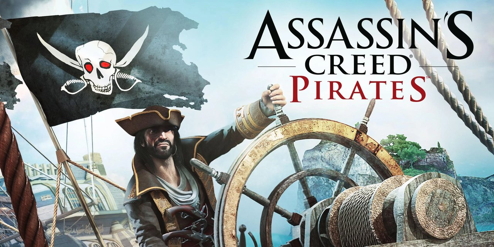

<p align="center">
  
</p>

<h3 align="center">Unofficial PS Vita port (BETA 0.81)</h3>

<p align="center">
  Install the VPK. Add your Android game files. Press START.
</p>

Assassin's Creed Pirates on PS Vita. You also get PS Vita trophies, online leaderboards and a setup on the console that prepares the game from your own Android files.

> [!WARNING]
> **This is a beta release, and you may run into problems.**
>
> The port has been tested by a small internal group of testers, but not yet by a wide audience, so some problems are probably still undiscovered. These can include crashes, glitches and slowdowns that are worse than the known slight frame-rate drops in heavy battles.
>
> - **Back up your save** (`ux0:data/acpirates/userdata`) from time to time.
> - **Please [report problems](#reporting-a-problem).** Finding them is the point of this beta.
> - Your save carries over when you update to a later version.

**[Download the beta](https://github.com/Cynostial/ac-pirates-vita/releases)**. No game files are included; you need your own copy of the Android game.

## Features

- **Physical controls**: sailing, all ship weapons, dodging and shooting down cannonballs, the world map and the temple runs. The touch screen still works too.
- **On-device setup** from your own APK and OBB. Setup checks the files, unpacks what the game needs and converts the OBB on the Vita. No PC tools needed, and you can pause and resume it.
- **Trophies**: all 99 achievements as PS Vita trophies, plus a platinum.
- **Online leaderboards** for bounty, player level and best temple run.
- **Vita settings** in the pause menu: invert right stick, FPS counter, performance mode and aim assist.
- **Save safety**: the saves from the last three launches are kept as backups.

## Requirements

- A PS Vita or PS TV with HENkaku/Ensō (or h-encore) and [VitaShell](https://github.com/TheOfficialFloW/VitaShell).
- [kubridge](https://github.com/bythos14/kubridge/releases): `ur0:tai/kubridge.skprx` listed under `*KERNEL` in `ur0:tai/config.txt`. Restart the Vita after adding it.
- The shader compiler `libshacccg.suprx` in `ur0:data/` or `ur0:data/external/`. If you don't have it, install and run [ShaRKF00D](https://github.com/OsirizX/ShaRKF00D) once. This file does **not** go in your plugin configuration.
- Your own **Assassin's Creed Pirates 2.9.1 for Android**: the APK and its OBB file (see below).
- Free space on `ux0:` for the APK and OBB, **plus about 900 MB while setup runs**. Afterwards the game folder takes about 900 MB.

## Supported game files

**Neither file is included with the port.**

| File | Supported version |
| --- | --- |
| APK | Android **2.9.1**, **ARMv7** (any file name ending in `.apk`) |
| OBB | The matching **main.253** OBB (any file name ending in `.obb`) |

On an Android device the OBB is in `Android/obb/com.ubisoft.assassin.pirates/`. **Copies from other sources work too.** A different signature, packaging or file name is fine, because setup checks the game files inside the APK and OBB, not the files themselves. Other versions of the game don't work; setup tells you if yours don't match.

<details>
<summary>Reference files used for testing</summary>

Your files don't have to match these checksums.

**APK**, 36,500,772 bytes

```text
49ac6c666f1c8482d09af0a8c33c2eadcc3c64e36173c416f7669de36d76d838
```

**OBB**, 817,249,909 bytes

```text
0bd4bb085dd8b6fbd37d31c9adb55a4ad891f9a91ee49454759497127f6cd704
```

</details>

## Installation

1. Download **ac-pirates-vita-0.81-beta.zip** from [Releases](https://github.com/Cynostial/ac-pirates-vita/releases) and extract it on your computer. The automatic "Source code" downloads don't contain the port.
2. Copy `ac-pirates.vpk` to the Vita and install it with VitaShell.
3. Create the folder `ux0:data/acpirates/` and copy your APK and OBB into it:

   ```text
   ux0:data/acpirates/
   ├── Assassins-Creed-Pirates-2.9.1.apk   (any name ending in .apk)
   └── main.253.com.ubisoft.assassin.pirates.obb   (any name ending in .obb)
   ```

4. Leave VitaShell's USB mode, start **AC Pirates** and press **START** on the setup screen. Setup checks the APK, unpacks what the game needs and converts the OBB into the format this port reads, replacing the original OBB. This takes a few minutes; keep the Vita charged.
5. When **Ready to play** appears, press **START**.

> [!NOTE]
> **Using USB on Windows?** If your Vita shows up as `D:`, the game folder is `D:\data\acpirates\`. Don't create an extra `ux0` folder.

**Need to pause setup?** Press **Circle**. Press **START** the next time you open the game; finished parts are checked and kept.

Keep `game.apk` and the converted OBB in `ux0:data/acpirates/`, because the game reads them every time. The very first start of the game itself is slower than later ones while it builds its shader and script caches.

## Controls

### Sailing

| Button | Action |
| --- | --- |
| Left stick | Steer |
| Right stick | Look around; push **up** for the spyglass |
| R / L | Raise sails, speed up / lower sails, slow down |
| Cross | Engage the nearest ship, barrel or target (a Cross sign marks it); confirm, advance dialogue |
| Square | Switch between deck view and the view behind the ship; leave the spyglass |
| SELECT | Tactical (top-down) view; the left stick steers there |
| START | Pause |
| Circle | Back |

**World map:** D-pad or left stick to move between places, Cross to select.

### Naval battles

| Button | Action |
| --- | --- |
| Square / Triangle / Circle | Ready Round Shot / Swivel Gun / Canister Shot (press again to put it away) |
| L / R | Ready Heavy Shot / Mortar |
| Left stick | Aim |
| Cross | Fire (hold for Canister Shot) |
| L / R (enemy fire) | Dodge left / right |
| L / R (incoming cannonballs) | Shoot down the ball on that side; each ball shows its button |
| Left stick (spider shot) | Push toward each dot in order |

### Mayan temple runs

| Button | Action |
| --- | --- |
| D-pad Left/Right or L/R | Turn, change lane, dodge aside, run along walls |
| Cross or D-pad Up | Jump, climb, grab ropes and poles |
| Circle or D-pad Down | Slide, dive |
| Square | Pick up; skip a cut-scene |
| Left stick | Steer to collect the Mayan stones (instead of tilting) |

**Menus:** D-pad or left stick to move, Cross to press, Circle to go back.

**Settings** (pause menu): invert right stick, FPS counter, performance mode (on by default; keep it on) and aim assist.

## Trophies

All 99 achievements are PS Vita trophies, plus a platinum. Homebrew trophies need the **NoTrpDrm** plugin (firmware 3.60 to 3.68):

1. Copy `NoTrpDrm.suprx` to `ur0:tai/`.
2. Add the line `ur0:tai/NoTrpDrm.suprx` under `*main` in the same `config.txt` that lists kubridge.
3. Restart the Vita.

Without the plugin the game plays the same, and the start menu tells you once per launch that trophies are unavailable. **DON'T SHOW** hides that message for good. Achievements you earned before installing the plugin become trophies the next time you sail.

## Online leaderboards

When Wi-Fi is on, your **bounty**, **player level** and **best Mayan temple run** are posted under your PS Vita user name to the leaderboard. Only the user name, an anonymous console code and these three scores are sent. Without Wi-Fi nothing is sent.

Open the boards with the podium button in the pause menu; **L/R** switch between boards.

## Saves and updates

Your save is in `ux0:data/acpirates/userdata`, and the saves of the last three launches are kept in `ux0:data/acpirates/save-backups`. **Never delete `ux0:data/acpirates/`.** While the port is in beta, copy `userdata` to your PC every now and then.

To update, install the new VPK over the existing app. Setup doesn't run again.

## Troubleshooting

| Message or problem | What to do |
| --- | --- |
| "kubridge is not running" | Install kubridge under `*KERNEL` in `ur0:tai/config.txt`, then restart the Vita. |
| "The shader compiler is missing" | Run ShaRKF00D once to extract `libshacccg.suprx`. |
| "No APK found" / "No OBB found" | The files aren't in `ux0:data/acpirates/`. Check the folder name and that the files end in `.apk` and `.obb`. |
| "This APK/OBB is not supported" | The file is a different version of the game. Use 2.9.1 for Android (ARMv7). |
| "The OBB is incomplete or was damaged while copying" | Copy the OBB again and press START. |
| "Free … MB more" | Delete something on `ux0:` and press START again. |
| Low frame rate | Keep **Performance mode** on (Settings). Heavy battle scenes run below 30 FPS. |

## Known limitations

- This is a beta. Beyond the points below, expect problems that the internal test group didn't run into.
- 30 FPS is not reached everywhere; heavy battle scenes run lower.
- Facebook, Game Center and the in-game store are not available.

## Reporting a problem

[Open an issue](https://github.com/Cynostial/ac-pirates-vita/issues) and describe what happened and what you did just before. Include `ux0:data/acpirates/runtime.log`, copied **right after** the problem, because each start of the game overwrites it.

## About this repository

This repository hosts the releases and documentation.

The port uses open-source libraries; they are listed in `licenses/COMPONENTS.txt` in the release zip, next to their licence texts. Source code for the LGPL libraries, including the modified vitaGL, is available on request through the issue tracker.

## Credits

- **Ubisoft**: Assassin's Creed Pirates.
- **VitaSDK, vitaGL, so_util, FalsoJNI, FalsoNDK, kubridge, TLSF** and the audio libraries: the tools and libraries that make this port possible.
- **KLM-corporation**: the Lua garbage-collector pacing is adapted from ac-pirates-arm64 (MIT).

The header image is official Ubisoft promotional art. Assassin's Creed and Ubisoft are trademarks of Ubisoft Entertainment. This is an unofficial fan port, not affiliated with or endorsed by Ubisoft or Sony.